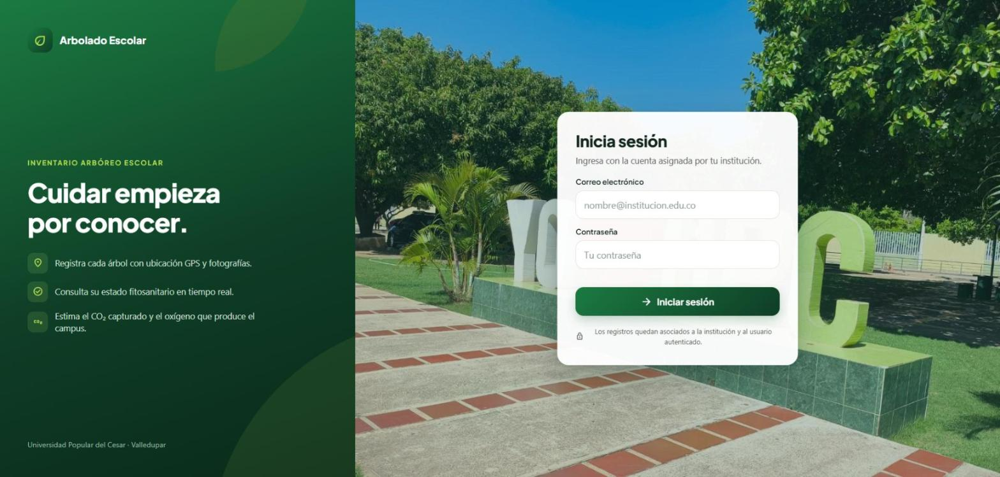
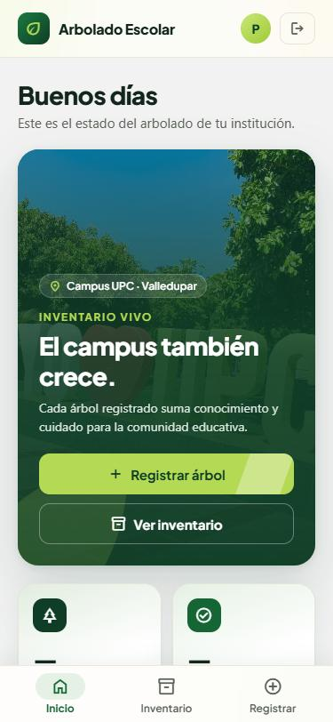
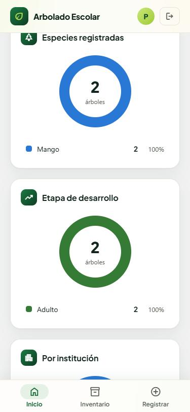
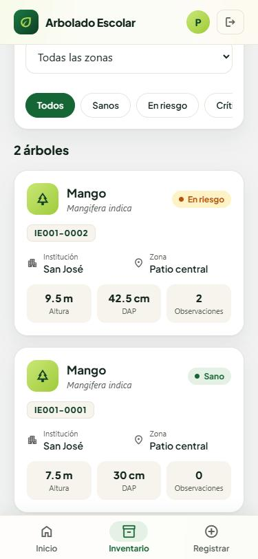
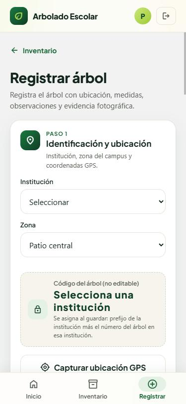

# Arbolado Escolar — Inventario Arbóreo Escolar

Aplicación para inventariar y cuidar los árboles de las instituciones educativas, desarrollada en
la **Universidad Popular del Cesar (Valledupar)**. Cada árbol se registra con su ubicación GPS,
medidas, observaciones fitosanitarias, agentes bióticos y fotografías; después se le hace
seguimiento con inspecciones que un docente revisa. Con esos datos la app calcula un semáforo de
salud (sano, en riesgo, crítico), recomienda intervenciones y estima la biomasa, el carbono, el CO₂
capturado y el O₂ producido.

Funciona en web, Android e iOS con un solo código, y se adapta a teléfonos, tablets y escritorio.
La versión web está publicada en **https://inventario-arboreo.vercel.app** (ver [Despliegue](#despliegue)).

<p align="center">
  
</p>

<table>
  <tr>
    <td align="center"><br><sub>Inicio</sub></td>
    <td align="center"><br><sub>Gráficos</sub></td>
    <td align="center"><br><sub>Inventario</sub></td>
    <td align="center"><br><sub>Registro</sub></td>
  </tr>
</table>

## Funcionalidades

### Árboles

- **Inicio de sesión y cuentas:** cada persona puede crear su cuenta desde "Crear una cuenta"
  (entra como estudiante y confirma su correo), y el administrador también las crea desde Usuarios
  con rol, institución y curso. El token se renueva solo; si la sesión expira o la cuenta está
  desactivada, la app vuelve al login con un aviso.
- **Inicio (dashboard):** cifras animadas del arbolado, impacto ambiental (CO₂, O₂ y biomasa),
  gráficos de dona por estado de salud, especie, etapa de desarrollo e institución, y accesos
  según el rol.
- **Inventario:** buscador y filtros por institución, especie, zona y estado de salud. Cada tarjeta
  muestra como portada la foto general más reciente del árbol.
- **Registro de árboles** por secciones:
  1. Identificación y ubicación: institución, zona del campus y captura del GPS.
  2. Fotografías: una general (obligatoria), una de detalle y hasta 3 adicionales.
  3. Especie y medidas: diámetro del tronco (DAP), altura y diámetro de copa.
  4. Interferencias y observaciones: daños a infraestructura, casillas fitosanitarias por parte
     del árbol (follaje, tronco, raíz y plagas) y agentes bióticos FB-01 a FB-06 (insectos,
     enfermedad, muestra de laboratorio, hemiparásitas, bejucos y epífitas).
- **Código del árbol automático:** no se escribe. El formulario muestra el prefijo de la
  institución (`IE001-····`) y la base de datos asigna el número al guardar (`IE001-0001`).
- **Ficha del árbol:** galería con todas sus fotos (visor a pantalla completa), historial de
  inspecciones, recomendaciones e intervenciones, y cálculos ambientales.
- **Inspecciones de seguimiento:** cada visita registra medidas, hallazgos, agentes bióticos y
  fotos. El registro del árbol es su primera inspección, y el estado del árbol sale de la última
  inspección no anulada.

### Módulos

| Grupo | Módulo | Para qué |
|---|---|---|
| Trabajo de campo | Revisión* | Confirmar o anular las inspecciones pendientes de la institución |
| | Intervenciones | Mantenimiento realizado, programado y recomendado por árbol |
| | Cursos y zonas | Zonas asignadas a cada curso, cobertura y productividad |
| Seguimiento y resultados | Mi progreso | Puntos, niveles, rachas, logros y rankings |
| | Reportes | Inventario, riesgo, cobertura, productividad e intervenciones por periodo |
| | Metas | Metas institucionales por indicador y su avance |
| Gestión institucional | Presupuestos* | Gasto ejecutado, comprometido y proyecciones |
| | Escenarios* | Simular cómo repartir un presupuesto entre las acciones pendientes |
| | Configuración* | Método de cálculo, pesos, umbrales y parámetros por institución |
| | Usuarios* | Crear cuentas; roles, instituciones, cursos y cuentas activas |

\* Solo para docentes y administradores.

### Roles

| Rol | Puede |
|---|---|
| Estudiante (por defecto) | Registrar árboles e inspecciones; consultar inventario, reportes, metas, cursos y rankings |
| Docente | Lo anterior, y además revisar inspecciones, registrar intervenciones y gestionar cursos **de su institución**; consultar presupuestos, escenarios y configuración |
| Administrador | Todo, en todas las instituciones: método de cálculo, parámetros, costos, presupuestos, metas, escenarios y usuarios |

Los permisos se validan en la API (con un mensaje claro) y también con RLS y triggers en Supabase,
para que no se puedan saltar llamando a Supabase directamente.

## Tecnologías

| Parte | Tecnologías |
|---|---|
| Frontend | Expo SDK 57, React Native 0.86, React 19, Expo Router, TypeScript, Zod 4, react-hook-form, TanStack Query 5, Zustand 5, axios, Reanimated 4, react-native-svg, expo-location, expo-image-picker |
| Diseño | Identidad visual "Campus UPC" (paleta tomada de la foto del campus) y tipografía Plus Jakarta Sans |
| Backend | Python 3.10+, FastAPI 0.142, Pydantic 2 |
| Datos | Supabase: PostgreSQL con RLS (cada usuario lee y escribe con su propio token), Auth y Storage para las fotos |
| Despliegue | Vercel (frontend web) y Railway (backend) |

```
App (Expo: web, Android, iOS)  →  API FastAPI  →  Supabase (PostgreSQL + RLS + Auth + Storage)
```

## Estructura del repositorio

```
Proyecto-arborizaci-n/
├── backend/                 # API en FastAPI conectada a Supabase
│   ├── main.py              # app, árboles, fotos de registro, catálogos y estadísticas
│   ├── routers/             # endpoints de los módulos (inspecciones, intervenciones, cursos…)
│   ├── servicios/           # calificación, recomendaciones, indicadores, gamificación, presupuesto y escenarios
│   ├── schemas.py           # modelos Pydantic y validaciones
│   ├── calculos.py          # biomasa, carbono, CO₂ y O₂
│   ├── auth.py, db.py       # token y perfil de quien llama, clientes de Supabase
│   ├── sql/                 # migraciones de Supabase (001 a 004, en orden)
│   ├── tests/               # pruebas (usan un Supabase falso)
│   └── railway.json         # arranque en Railway
├── frontend/                # App en Expo + React Native + TypeScript
│   ├── src/
│   │   ├── app/             # pantallas y rutas (Expo Router)
│   │   ├── features/        # auth, trees, inspections, interventions, courses, budgets,
│   │   │                    # goals, scenarios, reports, gamification, settings, perfil…
│   │   ├── shared/          # componentes, estilos y utilidades comunes
│   │   ├── services/        # cliente HTTP y almacenamiento de la sesión
│   │   └── config/          # paleta, tipografía y constantes
│   └── vercel.json          # compilación y rutas en Vercel
├── docs/capturas/           # imágenes de este README
└── README.md
```

## API

Los endpoints principales:

| Método | Ruta | Para qué |
|---|---|---|
| GET | `/salud` | Comprobar que la API está activa |
| POST | `/auth/login` · `/auth/refresh` | Iniciar sesión / renovar la sesión |
| POST | `/auth/registro` · `/auth/reenviar-confirmacion` | Crear una cuenta propia / reenviar el correo de confirmación |
| GET | `/catalogos` | Especies, instituciones y casillas fitosanitarias (público) |
| GET / PATCH | `/perfil` | Mi rol, institución y curso |
| POST / GET | `/arboles` | Registrar un árbol / listar con filtros y paginación |
| GET | `/arboles/{id}` | Detalle de un árbol |
| GET | `/arboles/{id}/calculos` | Biomasa, carbono, CO₂ y O₂ estimados |
| POST | `/arboles/{id}/fotos` | Subir una foto de registro |
| GET / POST | `/arboles/{id}/inspecciones` | Historial / nueva inspección de seguimiento |
| GET | `/revision/pendientes` | Inspecciones por revisar |
| GET | `/estadisticas` | Datos del dashboard |

Además hay endpoints para intervenciones, cursos, presupuestos, configuración, gamificación,
reportes, metas, escenarios y usuarios. La tabla completa, con quién puede usar cada uno, está en
[`backend/README_backend.md`](backend/README_backend.md#endpoints). Con el backend corriendo, la
documentación interactiva está en `http://127.0.0.1:8000/docs`.

## Validaciones

Los datos se validan tres veces: en el formulario, con mensajes en español mientras se escribe; en
la API, que es la que decide; y en la base de datos, con reglas `CHECK` (migración 003), para que
ningún dato fuera de rango entre aunque alguien use Supabase directamente.

| Dato | Regla |
|---|---|
| Diámetro del tronco (DAP) | mayor que 0 y máximo 500 cm (5 m) |
| Altura | mayor que 0 y máximo 25 m |
| Diámetro de copa | mayor que 0 y máximo 40 m |
| Ubicación GPS | dentro de Colombia; aviso si la precisión es peor que ±30 m o si el punto queda a más de 2 km de la institución. Obligatoria al registrar y opcional en el seguimiento |
| Textos de "Otra" (zona o interferencia) | obligatorios, de 3 a 120 caracteres |
| Observaciones | hasta 50, solo del catálogo |
| Agentes bióticos | un insecto o una enfermedad piden parte afectada y severidad (0 a 4); la muestra de laboratorio, su código; la hemiparásita, el porcentaje de copa |
| Correo del login | formato válido; se limpian espacios y mayúsculas |
| Filtros del inventario | la zona solo acepta valores del catálogo y la especie se busca tal cual, sin comodines |
| Fotos | JPG, PNG o WebP de máximo 5 MB; el formato se comprueba con el contenido real del archivo |

## Cómo levantar el proyecto

### Requisitos previos

- Python 3.10 o superior
- Node.js (versión LTS) y npm
- Las claves del proyecto de Supabase (las comparte el equipo backend)

### Backend

```bash
cd backend
python -m venv venv
venv\Scripts\activate        # Windows
source venv/bin/activate     # macOS/Linux

pip install -r requerimientos.txt
uvicorn main:app --reload
```

Antes de arrancarlo, copia `backend/.env.example` como `backend/.env` y completa las claves de
Supabase (ver [Variables de entorno](#variables-de-entorno)). La API queda en `http://127.0.0.1:8000`.

**Base de datos:** en un proyecto de Supabase nuevo, aplica una vez, en Supabase → SQL Editor y en
este orden:

1. `backend/sql/001_fase1_modulos.sql`: perfiles de usuario, cursos y zonas, método de cálculo y
   parámetros por institución (incluidos los puntos), inspecciones con su revisión, intervenciones
   y presupuestos.
2. `backend/sql/002_fase2_metas_escenarios.sql`: metas y escenarios.
3. `backend/sql/003_validaciones.sql`: los mismos límites que validan el formulario y la API
   (medidas máximas, coordenadas dentro de Colombia y largo de los textos "Otra").
4. `backend/sql/004_agentes_bioticos.sql`: las variables de agentes bióticos FB-01 a FB-06 en cada
   inspección.

No borran datos y se pueden ejecutar más de una vez. Después asigna el rol de administrador a tu
cuenta (instrucciones al final del primer archivo y en
[`backend/README_backend.md`](backend/README_backend.md#migraciones-de-la-base-de-datos)). Sin las
migraciones, los endpoints de los módulos responden 503.

### Frontend

```bash
cd frontend
npm install
npm run web
```

La versión web queda en `http://localhost:3000`. Para Android o iOS usa `npm start` (abre el
servidor de Expo para Expo Go o un emulador). Más detalles en [`frontend/README.md`](frontend/README.md).

### Variables de entorno

Cada carpeta maneja su propio `.env` (no se sube a Git), basado en su `.env.example`.

`backend/.env` (obligatorio):

```
SUPABASE_URL=https://TU_ID.supabase.co
SUPABASE_ANON_KEY=sb_publishable_...
SUPABASE_SERVICE_KEY=sb_secret_...
CORS_ORIGINS=
URL_FRONTEND=
```

`CORS_ORIGINS` es opcional: cualquier puerto de `localhost` y `127.0.0.1` ya está permitido.
`URL_FRONTEND` es la dirección pública del frontend; el enlace del correo que confirma una cuenta
nueva lleva ahí (sin ella, Supabase usa la Site URL del proyecto).

`frontend/.env` (opcional): solo hace falta para probar en un teléfono físico, apuntando a la IP
del computador en la misma red:

```
EXPO_PUBLIC_API_URL=http://192.168.1.20:8000
```

### Cuentas

Hay dos formas de crear una cuenta, y en las dos la base le genera el perfil:

- **La persona misma**, con "Crear una cuenta" en el inicio de sesión. Entra como estudiante sin
  institución; si Supabase tiene activo "Confirm email", primero abre el enlace que le llega. Un
  administrador le asigna rol, institución y curso en Módulos → Usuarios.
- **El administrador**, en Módulos → Usuarios → Crear una cuenta, con rol, institución, curso y una
  contraseña inicial. Esa cuenta entra de una vez, sin confirmar el correo.

Para que los correos de confirmación lleguen a los estudiantes, el dueño del proyecto en Supabase
debe configurar un SMTP propio y las URL de la app (ver
[`backend/README_backend.md`](backend/README_backend.md#cuentas)). Mientras tanto, el administrador
puede crear las cuentas desde la app.

## Pruebas y chequeos

| Parte | Comando | Estado actual |
|---|---|---|
| Backend | `python -m pytest -q` (dentro de `backend/`) | 144 pruebas; usan un Supabase falso y no necesitan claves |
| Frontend | `npm run typecheck`, `npm run lint` y `npm test` (dentro de `frontend/`) | 60 pruebas con Jest (`jest-expo`) |

En un clon nuevo, arranca Expo una vez (`npm run web`) antes de `npm run typecheck`: Expo genera
`expo-env.d.ts`, que trae los tipos de los archivos CSS y no se sube a Git.

Si clonas el proyecto en una carpeta cuyo nombre tiene paréntesis (por ejemplo `Nueva carpeta (7)`),
`npm test` y `npm run lint` fallan por cómo jest-expo y ESLint leen esas rutas en Windows. Usa una
carpeta sin paréntesis.

## Despliegue

| Parte | Dónde | Dirección |
|---|---|---|
| Frontend (Expo web) | Vercel, proyecto `inventario-arboreo` | https://inventario-arboreo.vercel.app |
| Backend (FastAPI) | Railway, proyecto `inventario-arboreo`, servicio `backend` | https://backend-production-2f7d.up.railway.app |
| Base de datos, Auth y fotos | Supabase, proyecto `inventario-arboreo` | migraciones `backend/sql/001` → `002` → `003` → `004` ya aplicadas |

Variables configuradas:

- Railway (`backend`): `SUPABASE_URL`, `SUPABASE_ANON_KEY`, `SUPABASE_SERVICE_KEY`, `CORS_ORIGINS`
  (los dominios de Vercel) y `URL_FRONTEND`. El arranque y la comprobación de salud (`/salud`) están en
  `backend/railway.json`.
- Vercel: `EXPO_PUBLIC_API_URL` con la dirección del backend. Se lee al compilar, así que si cambia
  hay que volver a desplegar el frontend. La compilación y las rutas dinámicas están en `frontend/vercel.json`.

Para publicar cambios desde una copia local con las CLI (`vercel login` y `railway login` una vez):

```bash
cd backend && railway up --service backend
cd frontend && vercel deploy --prod
```

## Flujo de trabajo del equipo

- Los cambios grandes y significativos se trabajan en una rama `feature/...`. Los ajustes pequeños
  se suman a la rama de trabajo en curso, sin abrir una rama o un PR para cada uno.
- Los cambios llegan a `main` mediante Pull Request, revisado por al menos un compañero.
- Nadie sube `venv/`, `node_modules/` ni `frontend/.expo/`: cada persona los genera a partir de
  `requerimientos.txt` y `package.json`.
- En el frontend, los paquetes se agregan con `npx expo install <paquete>` (elige versiones
  compatibles con el SDK de Expo), no con `npm install <paquete>`.
- Si el backend cambia la forma de los datos que devuelve (modelos Pydantic), hay que avisar al
  equipo de frontend antes de fusionar.
- Un cambio en la base de datos va como una migración nueva en `backend/sql/`, numerada en orden.

## Pendientes

- **Fórmulas ambientales:** las de `backend/calculos.py` son estimaciones (Chave et al., 2014, con
  una densidad de madera de 0.6 para todas las especies) y están por confirmar con el docente. La
  densidad, el factor de raíz y la fracción de carbono se pueden ajustar desde Configuración, sin
  tocar código.
- **Limitaciones conocidas** (correo de prueba de Supabase, plan gratuito, cálculos en
  memoria, etc.): ver [`backend/README_backend.md`](backend/README_backend.md#limitaciones-conocidas).
